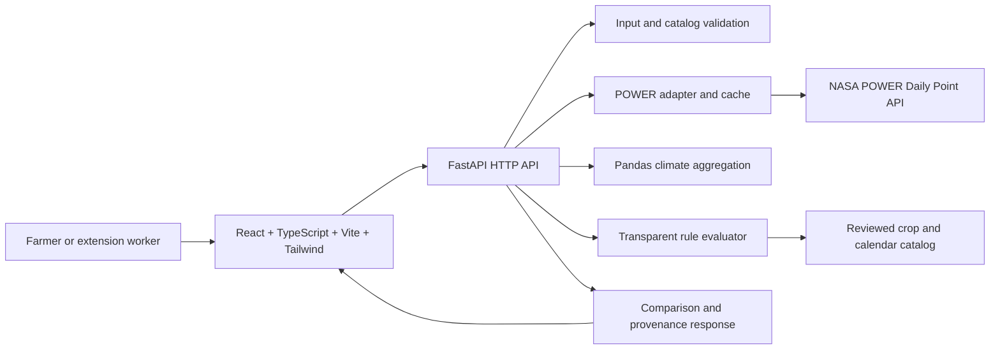

# Architecture, data dependencies, API contracts, and science review

**Status:** Proposed contracts for the event build. Endpoint shapes may change during implementation, but each change should be reflected here before frontend/backend integration.

## 1. System architecture



**Frontend modules:** Farm profile form; scenario comparison cards/table; climate evidence panel; methodology and uncertainty panel; typed API client; loading/error states. No business rules in components.  
**Backend modules:** Pydantic request/response models; POWER client with timeout/retry and cache; Pandas normalization/aggregation; immutable, versioned crop/window catalog; deterministic scenario generator; rule evaluator; error mapping. Keep raw NASA responses separate from normalized aggregates.  
**Collaboration:** `frontend`, `backend-data`, `backend-rules`, and `integration/science` as initial work lanes. One owner per Issue; another reviewer. A small PR should include the issue link, evidence of tests or manual QA, and any data-source change.

## 2. External data inventory

| Dependency | MVP use | Provenance and key limitation | Fallback / decision |
|---|---|---|---|
| [NASA POWER Daily Point API](https://power.larc.nasa.gov/docs/services/api/temporal/daily/) | Historical daily `T2M` and `PRECTOTCORR` for one point, `community=AG`, `format=JSON`, explicit `time-standard=LST`. Candidate parameter names and their AG units must be checked in the [POWER parameter dictionary](https://power.larc.nasa.gov/parameters/) before implementation. | Daily data cover 1981 onward; POWER is gridded and does not resolve field microclimate. Default is local solar time. Point requests allow at most 20 parameters. NASA warns against repeated requests for the same grid cell. | Cache by rounded/grid-equivalent point, parameter set, period, and time standard; show provenance and retrieval date. No “live forecast” claim. |
| Farmer-entered soil | Texture, drainage, optional measured pH and date/source. | Local self-report can be incomplete; texture and drainage categories are approximations. | Treat unknown as unknown. No hidden defaults. |
| Reviewed crop and calendar catalog | Names, families, growth windows, documented constraints and rule provenance. | [FAO Ecocrop](https://ecocrop.apps.fao.org/ecocrop/srv/en/cropSearchForm) exposes temperature, **annual** rainfall, pH, and crop cycle data; annual rainfall thresholds must not be compared directly with a growing-window rainfall sum. Local extension references are preferred for planting windows and rotation constraints. | Do not ship threshold rules until reviewed. Store citation, units, time basis, geography, reviewer, and version per rule. |
| Optional soil map, post-MVP | Regional context only. | [ISRIC SoilGrids](https://docs.isric.org/globaldata/soilgrids/SoilGrids_faqs_02.html) reports its REST API as paused/unstable; its [FAQ](https://docs.isric.org/globaldata/soilgrids/SoilGrids_faqs_04.html) cautions against farm-level use. | Do not make it a 48-hour dependency or present its estimates as local tests. |

NASA states that POWER meteorology comes from MERRA-2/GEOS assimilation, while solar variables are derived from satellite-informed radiation products. The MVP's temperature and precipitation are therefore NASA-provided modeled/assimilated climate context, not direct measurements of the farm. [NASA POWER FAQ](https://power.larc.nasa.gov/docs/faqs/data/). The API documentation also notes possible HTTP 422 and 429 responses. [NASA POWER API overview](https://power.larc.nasa.gov/docs/services/api/).

### Data processing contract

- Fix a historical baseline such as **2015–2024**, subject to reviewer approval, and record the exact dates in every response. Do not quietly replace missing years with newer ones.
- Request daily values once per point/period where practical; validate metadata, units, dates, and numeric missing-value markers from the actual response. Preserve `raw` and `normalized` provenance during development.
- For each reviewed growing window, calculate per-year mean daily temperature and total precipitation, then report the median and range across complete years. Require at least 8 of 10 usable years and at least 95% valid days in each accepted year; these are engineering data-quality thresholds, not agronomic thresholds. Display year count and coverage. Their adequacy needs review.
- Do not use the historical median as a prediction. A wet/dry label, water-demand value, or soil-health outcome needs its own scientific definition and review.

## 3. Initial API contracts (`/api/v1`)

JSON uses ISO 8601 timestamps, decimal latitude/longitude, explicit units, and stable machine-readable error codes. Examples are **illustrative shapes**, not data claims.

### `GET /api/v1/catalog`

Returns the active pilot region, catalog version, reviewed crop IDs/families, available windows, supported soil categories, and citations. The frontend must use IDs from this response rather than embed crop rules. `reviewStatus` is `approved` or `pending`; pending entries cannot produce `pass` or `fail` flags.

### `POST /api/v1/compare`

Request:

```json
{
  "location": {"latitude": 3.14, "longitude": 101.69},
  "soil": {"texture": "loam", "drainage": "well", "ph": null, "source": "farmer_report", "observedAt": null},
  "baselineCropIds": ["crop_a", "crop_b"],
  "windowIds": ["season_1", "season_2"],
  "priority": "balanced"
}
```

`priority` is one of `balanced`, `water_exposure`, `family_diversity`. It selects a **view**, and must not silently alter an agronomic score. Latitude range is −90 to 90, longitude −180 to 180. The catalog determines valid crop/window IDs. A baseline has exactly two crop IDs and windows exactly two distinct, consecutive approved IDs. Unknown soil fields are nullable.

Response (abridged):

```json
{
  "requestId": "opaque-id",
  "methodVersion": "draft-1",
  "catalogVersion": "pilot-1",
  "advisoryStatus": "exploratory_unvalidated",
  "climate": {
    "source": "NASA POWER Daily Point API",
    "sourceUrl": "https://power.larc.nasa.gov/docs/services/api/temporal/daily/",
    "parameters": ["T2M", "PRECTOTCORR"],
    "timeStandard": "LST",
    "period": {"start": "2015-01-01", "end": "2024-12-31"},
    "retrievedAt": "2026-11-05T00:00:00Z",
    "fromCache": true,
    "windows": [
      {"windowId": "season_1", "usableYears": 10, "coveragePct": 99.0,
       "temperature": {"median": null, "min": null, "max": null, "unit": "C"},
       "precipitation": {"median": null, "min": null, "max": null, "unit": "mm"}}
    ]
  },
  "scenarios": [
    {"id": "baseline", "kind": "baseline", "cropIds": ["crop_a", "crop_b"],
     "flags": [{"ruleId": "ph_rule", "status": "unknown", "reason": "Soil pH was not supplied",
                "observed": null, "criterion": null, "citationUrl": null}],
     "unknownCount": 1}
  ],
  "limitations": ["Historical regional climate is not a forecast or field measurement."]
}
```

The actual response must have **three scenarios** (baseline plus two alternatives) when the reviewed catalog permits them. The sample's `null` values show schema position only; a successful climate summary must contain finite numeric values. Scenario IDs and ordering are deterministic; if fewer than two eligible alternatives exist, return an explicit `NO_COMPARABLE_SCENARIOS` result with reasons rather than pad the list. Any rule citation may be null only when the status is `unknown` because no reviewed rule exists.

### `GET /api/v1/health`

Returns service status and catalog version; does not call NASA on every health check.

### Errors

| HTTP | Code | Meaning / UI behavior |
|---|---|---|
| 422 | `INVALID_INPUT` | Invalid coordinates, category, or crop/window IDs; mark affected fields. |
| 422 | `UNREVIEWED_CATALOG` | Requested rule/catalog is pending; show evidence-only comparison where possible. |
| 503 | `CLIMATE_UNAVAILABLE` | NASA failure and no acceptable cache; offer retry, no fabricated result. |
| 422 | `INSUFFICIENT_CLIMATE_COVERAGE` | Valid years below threshold; show coverage and withhold rule flags needing climate. |
| 422 | `NO_COMPARABLE_SCENARIOS` | Fewer than two alternatives; explain catalog constraints. |

Error body: `{"error":{"code":"CLIMATE_UNAVAILABLE","message":"...","details":{}},"requestId":"opaque-id"}`. The backend should not expose raw upstream errors or personal data in logs.

## 4. Scientific assumptions, risks, and required review

| ID | Assumption or risk | Consequence | Required decision / mitigation |
|---|---|---|---|
| S-01 | POWER grid values represent a farm. | Microclimate, topography, and localized storms may differ. | Label as regional historical context; seek local station comparison if feasible. NASA notes grid elevation can differ in complex terrain. [POWER FAQ](https://power.larc.nasa.gov/docs/faqs/data/). |
| S-02 | A 10-year historical baseline describes future conditions. | Climate shifts and extremes can make it misleading. | Show period, spread, and no forecast claim; reviewer chooses baseline and interpretation. |
| S-03 | Crop thresholds apply to the selected geography and growth stage. | False suitability flags. | Cite each threshold and match temporal basis; obtain local agronomist/extension review. [FAO Ecocrop](https://ecocrop.apps.fao.org/ecocrop/srv/en/cropSearchForm) is a starting point, not validation. |
| S-04 | Annual crop rainfall ranges can represent two-slot seasonal needs. | Invalid comparison. | Prohibit direct annual-vs-season comparison; find seasonal/growth-stage source or leave rule unknown. |
| S-05 | A legume in sequence improves soil automatically. | Nitrogen fixation depends on species, inoculation, management, and conditions. | Show only family diversity unless a locally reviewed soil-health effect model exists. [FAO crop-rotation overview](https://www.fao.org/family-farming/detail/en/c/1401678/). |
| S-06 | Soil texture, drainage, and pH are known. | Mistaken constraints. | Require user source/date for pH; allow unknowns; advise local soil testing. |
| S-07 | Rainfall is irrigation demand or water saving. | Incorrect resource claims. | Call it historical precipitation exposure only; no irrigation savings claim without ET/crop coefficient/management data. |
| S-08 | Crop family alternation controls pests or disease. | Actual breaks vary by pathogen and region. | Only display family sequence until locally reviewed rotation interval rules exist. |
| S-09 | Missing daily values do not bias summaries. | Climate summaries and flags could be wrong. | Enforce completeness checks, show usable years, and fail closed for affected indicators. |
| S-10 | Automatic ranking is scientifically meaningful. | False confidence in one option. | MVP has no overall numeric score or “best crop” label. Compare evidence and let the farmer choose with local advice. |

### Scientific review decisions before implementation of rules

1. Pilot region and intended farming system (rainfed or irrigated), with local reviewer named.
2. Two planting/growing windows and whether their months and crop cycle lengths fit locally.
3. Three or four crop species/varieties, catalog source, and whether each is realistic for both windows.
4. Valid temperature, precipitation, soil pH/texture/drainage, and rotation-family rules; units, geography, growth stage, and source page for each. Mark unsupported rules `unknown`.
5. Historical baseline period, local solar time choice, completeness thresholds, and treatment of extremes.
6. Acceptable language for uncertainty, farmer priorities, and whether any display order implies endorsement.
7. Whether independent local observations or an extension worker can check at least one pilot example. This is validation work, not a precondition for showing a clearly labeled exploratory demo.

**Evidence rule:** A citation establishes where a value or concept came from; it does not validate a resulting rotation. Do not claim candidate crop rotations are scientifically validated until a qualified local review and appropriate empirical evidence support that claim.
