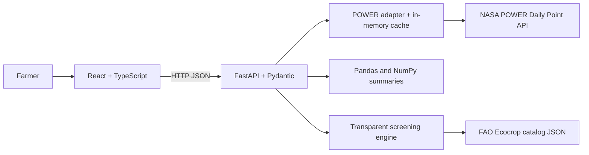

# Architecture

AgriShift AI is a small monorepo with a Vite/React client and FastAPI service. The client holds only transient farm state and calls the service over JSON. No account, personal identifier, or database is needed. A bounded in-memory cache stores NASA POWER responses for a process lifetime; it is lost on restart.

Routes: `/` introduction, `/farm` input/map, `/climate` historical charts, `/planner` choices and weights, `/results` criterion-level comparison. A typed fetch client in `frontend/src/api.ts` owns request/response types and structured error mapping. The backend exposes `/api/health`, `/api/crops`, `/api/climate`, and `/api/rotations/evaluate`; `/docs` is generated OpenAPI.

The current crop anchors every two-crop sequence. Candidate crops are possible next crops. The API returns source links, units, missing-data status, exclusions, and limitations. CORS origins come from `AGRISHIFT_CORS_ORIGINS`; production must use the exact Vercel origin. `VITE_API_BASE_URL` points the client to the API.

The repo includes GitHub Actions jobs for frontend lint/tests/build and backend tests. See [methodology](methodology.md) for computation and [limitations](limitations.md) for scientific scope.
