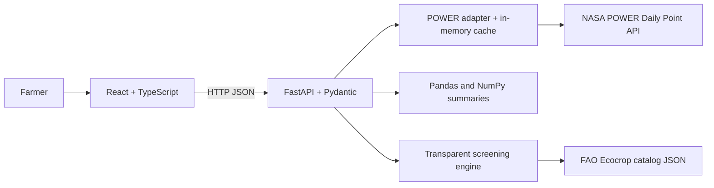

# Architecture

AgriShift AI is a small monorepo with a Vite/React client and FastAPI service. The client holds only transient farm state and calls the service over JSON. No account, personal identifier, or database is needed. A bounded 256-entry in-memory cache stores NASA POWER responses for a process lifetime; it is lost on restart.

The crop API serves two collections. `crops` contains the three FAO Ecocrop profiles used by the exploratory two-crop screen. `regional_context` contains five sourced Kedah staple and industrial crops with no agronomic thresholds. The hypothetical default is paddy with soil and irrigation marked unknown. Selecting a regional context crop permits climate exploration and a source review screen; the planner does not offer seasonal evaluation. The backend independently returns `CROP_CONTEXT_ONLY` before a NASA request if a client submits one of those IDs for evaluation.

Routes: `/` introduction, `/farm` input/map, `/climate` historical charts, `/planner` choices and weights, `/results` criterion-level comparison. A typed fetch client in `frontend/src/api.ts` owns request/response types and structured error mapping. The backend exposes `/api/health`, `/api/crops`, `/api/climate`, and `/api/rotations/evaluate`; `/docs` is generated OpenAPI.

Within the older exploratory catalog, the current crop anchors every two-crop sequence. Candidate crops are possible next crops. The API returns source links, units, missing-data status, criterion flags, evidence gaps, exclusions, and limitations. Nested Pydantic response models define the OpenAPI contract.

The repository-root `vercel.json` defines two Vercel services in one project: `/api/*` reaches FastAPI and all other paths reach the Vite build, with an internal SPA fallback. The production client uses same-origin `/api` requests when `VITE_API_BASE_URL` is unset, so no cross-origin browser call is required. Local development can override the API URL; `AGRISHIFT_CORS_ORIGINS` controls allowed cross-origin calls for separate-host setups. The in-memory NASA cache is per function instance and is not shared or persistent on Vercel.

The repo includes GitHub Actions jobs for frontend lint/tests/build and backend tests. See [methodology](methodology.md) for computation and [limitations](limitations.md) for scientific scope.
